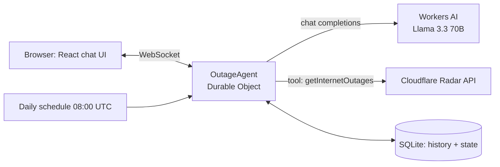

# Outage Agent

An AI chat agent, built on Cloudflare, that answers questions about internet outages using live data from [Cloudflare Radar](https://radar.cloudflare.com/). Ask it "Any internet outages in Iraq recently?" and it fetches real outage annotations, then explains what happened, where, for how long and why, in plain language.

**Live demo:** https://outage-agent.vikas-dev.workers.dev

## What it does

- Answers outage questions from real Radar data (not invented by the model)
- Remembers things you tell it (for example, which countries you care about) across sessions
- Can monitor a country for you on a daily schedule, but only after you approve it
- Streams replies and keeps conversation history across page refreshes

Try these prompts:

1. `Any internet outages in Iraq recently?`
2. `Remember that I care about India`
3. `Watch IQ for outages every day` (shows an Approve / Reject card)
4. Refresh the page, then ask `What do you remember about me?`

## How it meets the assignment

| Requirement | Implementation | Where |
|---|---|---|
| **LLM** | Llama 3.3 70B (`@cf/meta/llama-3.3-70b-instruct-fp8-fast`) on Workers AI | `src/server.ts` |
| **Workflow / coordination** | `OutageAgent`, a Durable Object built on the Cloudflare Agents SDK. It runs the model, tool call, result, answer loop (capped at a few steps), pauses for human approval, and runs a daily scheduled check | `src/server.ts` |
| **User input** | React chat UI connected to the agent over WebSocket, with streaming and an approval prompt | `src/client/` |
| **Memory / state** | Chat history is persisted in the agent's SQLite storage. Long-term state (saved notes, watched countries, latest alerts) lives in agent state and is fed back into the system prompt every turn | `src/server.ts` |

## Architecture



### Tools the model can call

| Tool | What it does | Notes |
|---|---|---|
| `getInternetOutages` | Fetches recent outages for a country from Radar and trims them to the fields the model needs (time, cause, type, places, networks, source) | Empty results are valid and reported as such |
| `remember` | Saves a short fact about the user to agent state | Keeps the last 20 notes |
| `watchCountry` | Adds a country to a daily watch list and schedules the check | Requires explicit user approval |

## Project structure

```
outage-agent/
├── wrangler.jsonc        Durable Object, SQLite migration, assets, vars
├── vite.config.ts        React + Cloudflare Vite plugin
├── index.html
├── .dev.vars.example     template for local secrets
└── src/
    ├── server.ts         the agent: model, tools, state, schedule
    ├── prompts.ts        system prompt
    ├── tools/radar.ts    Radar API wrapper
    └── client/           React chat UI (App.tsx, main.tsx, styles.css)
```

## Design decisions

- **One Durable Object per visitor.** The browser generates a random ID, stored in `localStorage`, and uses it as the agent name. Each visitor gets private history and memory.
- **Human-in-the-loop for anything with lasting effect.** Setting up a recurring watch needs an explicit approval click, so the agent never commits the user to something silently.
- **Grounded answers.** The prompt tells the model to use the Radar tool for outage questions and never to invent data. The tool trims Radar's large response to a few fields, so the model gets less noise and fewer tokens.
- **Bounded tool loop.** The step limit stops the model from calling tools repeatedly, which Llama 3.3 tends to do when a result is empty.
- **Least-privilege secrets.** The Radar token has Radar read access only. A separate token handles Workers AI. Both are stored as Worker secrets, never in the repo.

## Known issue and workaround

The usual way to call Workers AI from the AI SDK is the `workers-ai-provider` package with the `AI` binding. While building this I hit a documented bug in that path: streamed text arrived with every word doubled ("ThisThis task task...") and tool calls failed silently. It is described in [cloudflare/ai#663](https://github.com/cloudflare/ai/pull/663), which reports that Workers AI's `/ai/run` streaming sends each payload twice in one chunk and that published versions of the provider are affected.

**Workaround:** the agent calls Workers AI's OpenAI-compatible endpoint (`/ai/v1/chat/completions`) through `@ai-sdk/openai-compatible`, which does not send duplicates. It is still Workers AI running Llama 3.3. A small `fetch` wrapper in `src/server.ts` fixes two format mismatches between the SDK and this endpoint:

1. **Requests:** message `content` is flattened to a plain string, and assistant tool-call messages get an empty-string `content` instead of `null`.
2. **Responses:** a streamed `delta.content` that arrives as a number is converted to a string.

Once the provider fix is released, this can be switched back to the `AI` binding by removing the wrapper and the extra API token.

## Run locally

Requirements: Node.js 18+, a Cloudflare account with a workers.dev subdomain registered.

```bash
npm install
cp .dev.vars.example .dev.vars    # then fill in the two tokens below
npm run types
npm run dev                       # http://localhost:5173
```

`.dev.vars`:

```
CF_API_TOKEN=...    # API token with Account > Radar > Read
AI_API_TOKEN=...    # API token from the "Workers AI" template
```

Set your own account ID in `wrangler.jsonc` under `vars.CF_ACCOUNT_ID`.

## Deploy

```bash
npx wrangler secret put CF_API_TOKEN
npx wrangler secret put AI_API_TOKEN
npm run deploy
```

Use `npx wrangler tail` to watch live logs.

## Limitations

- Radar only lists notable, confirmed outages, so many countries return no results for a given window. The agent reports this plainly instead of guessing.
- The public URL is open, and every message uses Workers AI quota. There is no rate limiting or authentication yet.
- The daily watch check is implemented with the Agents SDK scheduler. ADD A NOTE HERE after you have seen it run (or say it is untested in production).
- Only country-level lookups are supported, not individual networks (ASNs).

## Possible next steps

- Rate limiting and basic auth on the public endpoint
- Look up outages by network (ASN), not just country
- Show watch results proactively when the user returns
- Switch back to the `AI` binding when the upstream streaming fix ships

## Built with

Cloudflare Workers, Durable Objects, Workers AI, Cloudflare Agents SDK, Cloudflare Radar API, Vercel AI SDK, React, Vite